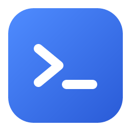

<div align="center">



# RoveTerm

**A Next-Generation Cross-Platform Smart Terminal — Uniting SSH, Embedded Tailscale, SFTP, Live Telemetry, and AI Ops in One Native App**

[](https://github.com/Gabrlie/RoveTerm/stargazers)
[](https://github.com/Gabrlie/RoveTerm/releases)
[](Cargo.toml)
[](src-tauri/tauri.conf.json)
[](package.json)
[](LICENSE)

[🇨🇳 简体中文](README.md) • [🇺🇸 English](README.en.md) • [📝 Changelog](CHANGELOG.md) • [📖 Development Guide](docs/development.md) • [🏗️ Architecture](docs/architecture.md) • [🐛 Issues](https://github.com/Gabrlie/RoveTerm/issues)

</div>

## 📋 Overview

**RoveTerm** is a lightweight, cross-platform smart terminal built on a **Rust static-plugin kernel + Tauri 2 + Svelte 5**, targeting Windows, macOS, Linux, and Android (mobile adaptation in progress).

Instead of bouncing across separate terminal windows, SFTP apps, VPN clients, monitoring dashboards, and AI chats, RoveTerm unifies **multiplexed SSH, an embedded Tailscale engine, SFTP with a workspace code editor, port forwarding, live server telemetry, an encrypted credential vault with E2EE sync, and policy-gated AI & Fleet Ops** inside a single crisp native window.

## ✨ Key Features

- 🚀 **Lightweight Native Architecture** - Powered by a Rust plugin core, Tauri 2, and Svelte 5 with zero heavy Electron overhead and optional WebGL terminal rendering
- 🪟 **VSCode-Style Workspace** - Multi-tab groups, arbitrary horizontal/vertical splits, drag-and-drop tab transfers without dropping live sessions, and automatic workspace restore
- 🔌 **Multiplexed SSH Engine** - Terminals, SFTP, and live telemetry share one SSH connection per host; supports multi-hop jump hosts (`ProxyJump` import), HTTP/SOCKS5 proxies, and strict host-key verification
- 🌐 **Embedded Tailscale Engine** - Built-in `tailscale-rs` on desktop with no external daemon required: peer device dialog, batch latency probes, **Direct vs. DERP relay region** badges, and one-click host route conversion
- 📂 **SFTP & Workspace Code Editor** - Drag-and-drop transfer queue with conflict prompts; double-click text/config files to edit in built-in CodeMirror 6 tabs beside terminals, or edit externally via the OS default app with auto-upload on save
- 🔀 **Port Forwarding Manager** - Saved local (`-L`), remote (`-R`), and dynamic SOCKS5 (`-D`) rules per host with auto-start on connect and live active connection counts
- 📊 **Live Server Status & Terminal Mini Bar** - Per-core CPU charts, memory/swap, interface throughput, disk usage, and a customizable bottom status bar on remote terminals
- 🤖 **AI Assistant & Local ACP Agents** - Built-in providers (OpenAI, Anthropic, DeepSeek, OpenRouter, Ollama, and compatible APIs) alongside local ACP agents (Codex, Claude Code, custom commands), plus an opt-in MCP server bridge
- 🧭 **Fleet Ops Lead & Scheduled Checks** - Concurrent multi-host task orchestration with a dedicated sub-agent panel, durable checkpoints, automatic result summaries, scheduled runs, and local risk-based approvals
- 🔐 **Per-Field Encryption & E2EE Sync** - OS Keychain master keys with XChaCha20-Poly1305 per-field encryption, a built-in Key Library, and end-to-end encrypted multi-device sync via local folder or WebDAV
- 📜 **In-App Log Viewer** - Filter and search runtime logs by severity level and keyword directly inside Settings
- 🔄 **Signed In-App Updater** - Quiet update checks, minisign signature verification, and one-click in-app installation

## 🗺️ Roadmap / TODO List

- [x] **Update Checking & Signed In-App Updater** - Desktop `tauri-plugin-updater` minisign verification, GitHub Releases fallback, and `latest-android.json` manifest
- [ ] 🐳 **Docker Management** - Start/stop local & remote containers, live log streaming, one-click container `exec` shells, image/volume/network inspection, and Compose stack views
- [ ] 🧵 **Process & Network / Port Thread Inspector** - Live process tree, per-thread CPU & memory breakdown, listening port lookup, and active TCP/UDP socket tracing
- [ ] 📱 **Android & iOS Mobile Polish** - Touch shortcut toolbar, gesture navigation & splits, Android Keystore / iOS Keychain unlock, Android in-app APK SHA-256 verification & native `PackageInstaller`, and adaptive mobile layouts
- [ ] ☁️ **More Sync Backends & Distribution Channels** - Graphical onboarding for S3 / Gist sync backends alongside Homebrew, Winget, AUR, and Flatpak packaging

## 🚀 Local Development & Builds

### Prerequisites

- **Rust stable** (see [rust-toolchain.toml](rust-toolchain.toml))
- **Node.js >= 24** and **pnpm**
- **Linux desktop packages**: `webkit2gtk-4.1`, `libsoup-3.0`, `javascriptcoregtk-4.1`, and a Secret Service daemon (e.g. GNOME Keyring)

### Desktop Dev Mode

```bash
# Install frontend dependencies and Git workflow hooks
pnpm install

# Launch desktop dev build
pnpm tauri dev

# Optional: start the local test SSH server in another terminal (demo / demo)
cargo run -p devsshd -- --addr 127.0.0.1:2222
```

### Production & Cross-Platform Builds

```bash
# Build native installers for the current OS
pnpm tauri build

# Build an ad-hoc-signed macOS Universal bundle (Apple Silicon + Intel)
rustup target add aarch64-apple-darwin x86_64-apple-darwin
APPLE_SIGNING_IDENTITY="-" pnpm tauri build --target universal-apple-darwin --config '{"bundle":{"createUpdaterArtifacts":false}}'

# Cross-build Windows x64 NSIS installer from Linux
pnpm build:windows

# Android debug APK (requires ANDROID_HOME, NDK_HOME, and JDK 17)
pnpm tauri android build --debug --apk --target aarch64
```

### Manual Signed Releases (`gh`)

```bash
# 1. Bump Cargo.toml and package.json in lockstep
pnpm release:bump 0.2.0

# 2. Build signed updater artifacts with your local minisign private key (never committed)
TAURI_SIGNING_PRIVATE_KEY_PASSWORD="" TAURI_SIGNING_PRIVATE_KEY="$(cat ~/.tauri/roveterm.key)" pnpm tauri build

# 3. Collect artifacts and generate latest.json / latest-android.json / SHA256SUMS.txt / RELEASE_NOTES.md
pnpm release:prepare --tag v0.2.0
```

For a manual macOS release, add `APPLE_SIGNING_IDENTITY="-"` to the build command. The example uses a passwordless updater key.

> See [docs/development.md](docs/development.md) for multi-machine `--merge-latest` merging, platform notes, and test commands.

## 🏗️ Technical Architecture

### Frontend Stack
- **Svelte 5 (Runes)** - Fine-grained reactive UI with minimal runtime footprint
- **TypeScript** - End-to-end typed IPC wrappers and pure domain logic modules
- **Vite** - Fast dev server and optimized production bundling
- **xterm.js 6** - Full-featured terminal emulator (WebGL, Fit, Search, Unicode11, Web Links)
- **CodeMirror 6** - Workspace-tab text & code editor with syntax highlighting and find/replace
- **Marked** - Safe token-based Markdown rendering (plain elements only, never raw HTML)
- **Lucide & Simple Icons** - Cohesive icon set and operating system brand marks

### Backend & Core Stack
- **Rust (2024 Edition) & Tauri 2** - Fast, memory-safe native application shell
- **rove-kernel** - Static-plugin kernel with service registry, Journal/Live/Waterfall event bus, and `Disposer` teardown
- **Tokio & russh** - Async runtime and pure-Rust SSH, SFTP, and port-forwarding multiplexer
- **SQLite (rusqlite) & XChaCha20-Poly1305 / Argon2id** - Durable journal, per-field encrypted vault, and E2EE sync
- **rustls + ring** - Unified pure-Rust TLS stack across desktop and mobile without OpenSSL
- **tailscale-rs** - Embedded desktop tailnet runtime (WireGuard, Disco path probing, DERP relays)
- **tauri-plugin-updater (minisign)** - Signed release verification and in-app desktop updates

### System & Protocol Integrations
- **PTY / ConPTY** - Native cross-platform interactive local shells
- **OS Keychain / Android Keystore** - Hardware/OS-backed device master keys with silent startup unlock
- **ACP & MCP** - Native integration with local AI agents and external MCP clients
- **WebDAV / Folder Sync** - Ciphertext-only sync segments over local folders or standard WebDAV servers

## 📁 Project Structure

```text
RoveTerm/
├── crates/                     # Standalone Rust plugin crates (decoupled from Tauri)
│   ├── rove-kernel/           # Context, service registry, event bus, Disposer, Profile
│   ├── rove-session/          # Terminal session lifecycle, coalescing, replay buffer
│   ├── rove-pty/              # Local PTY transport (Unix PTY / Windows ConPTY)
│   ├── rove-ssh/              # Multiplexed SSH, known_hosts, ssh_config, SFTP, forwards, OS probe
│   ├── rove-fs/               # FileSystem seam, local FS, and transfer queue
│   ├── rove-vault/            # Hosts, keys, prefs, and XChaCha20-Poly1305 field encryption
│   ├── rove-journal/          # SQLite durable event journal
│   ├── rove-sync/             # E2EE multi-device sync (local directory / WebDAV)
│   ├── rove-http/             # Shared HTTPS client builder (rustls + ring)
│   ├── rove-tailscale/        # Embedded desktop Tailscale service and TCP dialer
│   ├── rove-ai/               # AI assistant, risk classifier, policy gate, ACP & MCP bridge
│   └── rove-ops/              # Persistent fleet operations, scopes, and worker scheduler
├── src-tauri/                  # Tauri 2 shell (desktop / mobile profiles & IPC commands)
│   ├── src/commands/          # Domain-scoped IPC commands (session, sftp, tailscale, ai, update…)
│   ├── profiles/              # Built-in desktop & mobile plugin profiles
│   └── tauri.conf.json        # App config, strict CSP, and updater public key
├── ui/                         # Svelte 5 + TypeScript frontend
│   └── src/lib/               # terminal, layout, files, hosts, panels, ai, tailscale, update, i18n
├── tools/
│   └── devsshd/               # Lightweight SSH server for local development and tests
├── scripts/                    # Doc budget checker, Git workflow hooks, and manual release helper
├── docs/                       # Architecture, security model, dev guide, subsystems, and ADRs
├── third_party/                # Pinned upstream patches (tailscale-rs fixes)
├── CHANGELOG.md                # Complete bilingual changelog
├── AGENTS.md                   # Repository engineering & AI collaboration guidelines
└── Cargo.toml                  # Rust workspace and single source of truth for versioning
```

## ⌨️ Common Shortcuts

> `App` maps to `⌘` on macOS and `Ctrl+Shift` on Windows/Linux, keeping plain `Ctrl+<letter>` free for your shell.

| Shortcut | Action | Shortcut | Action |
|---|---|---|---|
| `App+T` | New local terminal | `App+P` | Command palette |
| `App+K` | Quick connect (`user@host:port`) | `App+,` | Settings |
| `App+D` / `App+E` | Split right / Split down | `App+B` | Toggle host sidebar |
| `App+]` / `App+[` | Focus next / previous split group | `App+L` / `App+J` | Toggle right / bottom files panel |
| `App+O` | Open SFTP beside terminal | `App+I` | Open AI assistant panel |
| `App+S` / `App+F` | Editor save / Find & replace | `App+W` | Close active tab or pane |

## 📦 Quick Download

> Click a platform badge below to jump to the latest GitHub Release. Every release ships with **per-architecture direct download badges** and **SHA-256 checksums**; desktop builds support **minisign-verified in-app auto-updates**.

<div align="center">

| Platform | Direct Packages | Auto-Update Support |
|---|---|---|
| **macOS** | [](https://github.com/Gabrlie/RoveTerm/releases/latest) [](https://github.com/Gabrlie/RoveTerm/releases/latest) [](https://github.com/Gabrlie/RoveTerm/releases/latest) | ✅ Signed in-app updates (`.app.tar.gz`) |
| **Windows** | [](https://github.com/Gabrlie/RoveTerm/releases/latest) [](https://github.com/Gabrlie/RoveTerm/releases/latest) | ✅ Signed in-app updates (NSIS `.exe`) |
| **Linux** | [](https://github.com/Gabrlie/RoveTerm/releases/latest) [](https://github.com/Gabrlie/RoveTerm/releases/latest) [](https://github.com/Gabrlie/RoveTerm/releases/latest) | ✅ AppImage in-app signed updates |
| **Android** | [](https://github.com/Gabrlie/RoveTerm/releases/latest) | 🚧 Manifest & SHA-256 check ready (see Roadmap) |

</div>

> See [**CHANGELOG.md**](CHANGELOG.md) for the full bilingual version history.

## 📄 License

This project is licensed under the **MIT License** — see [LICENSE](LICENSE) for details.

---

<div align="center">

**✨ Making multi-server ops and terminal workflows fast, safe, and enjoyable!**

**RoveTerm — Lightweight, Secure, Cross-Platform Smart Terminal**

[📦 Download Latest](https://github.com/Gabrlie/RoveTerm/releases/latest) | [📝 Changelog](CHANGELOG.md) | [🐛 Issues](https://github.com/Gabrlie/RoveTerm/issues)

</div>
